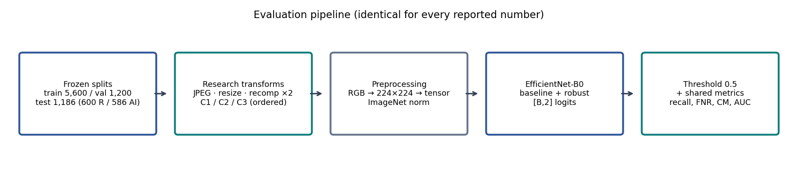
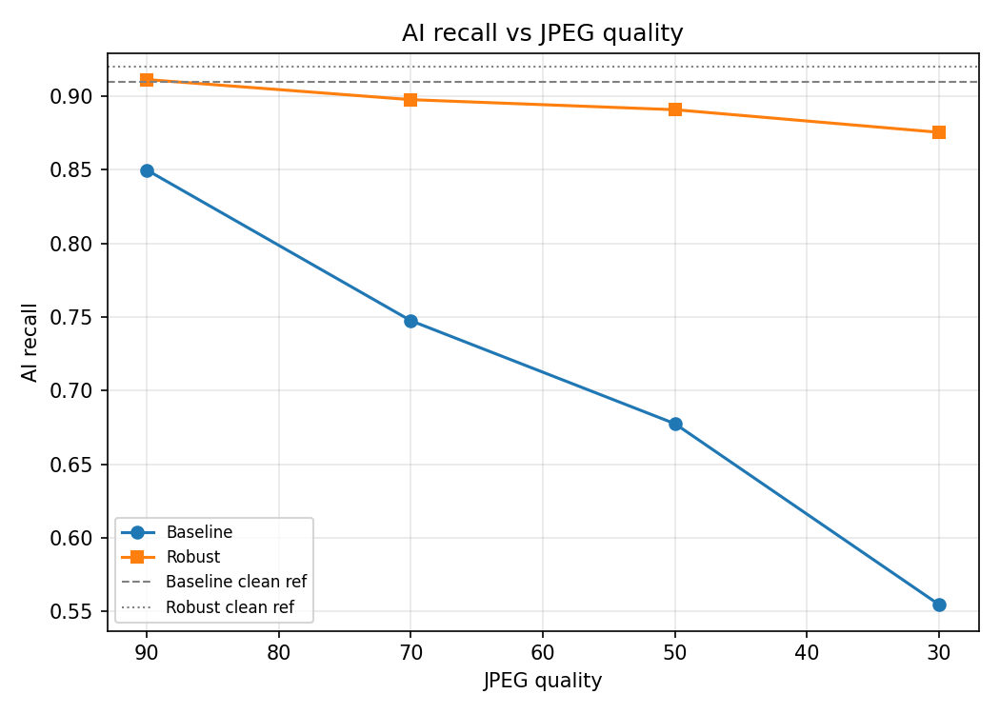
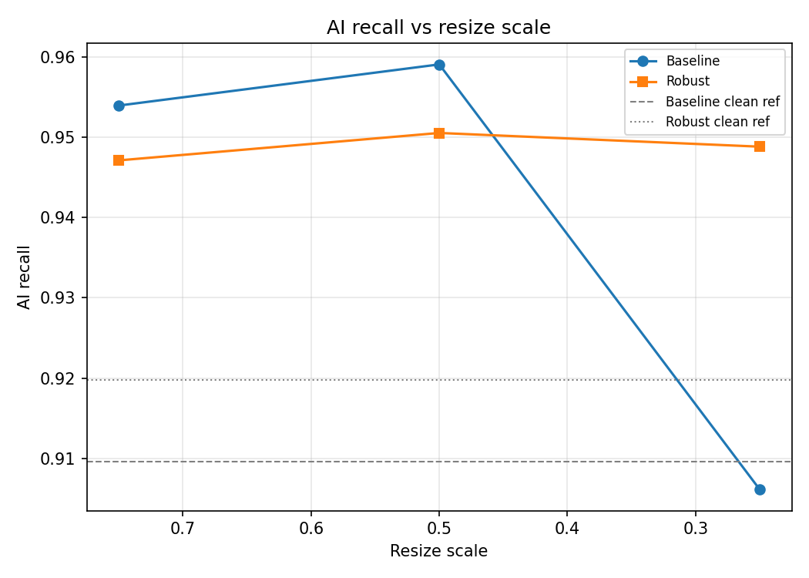
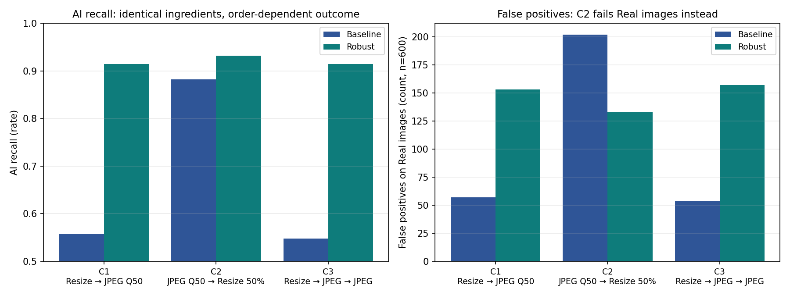
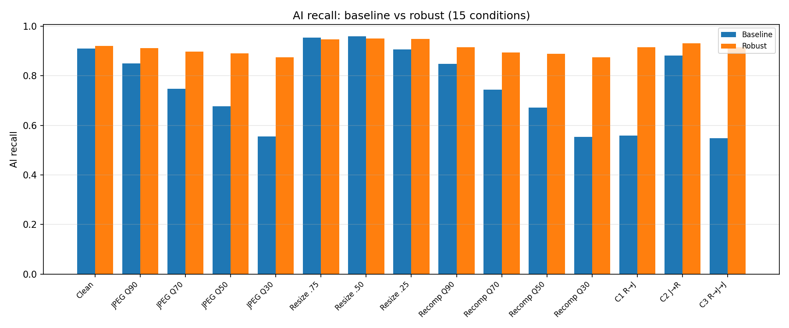
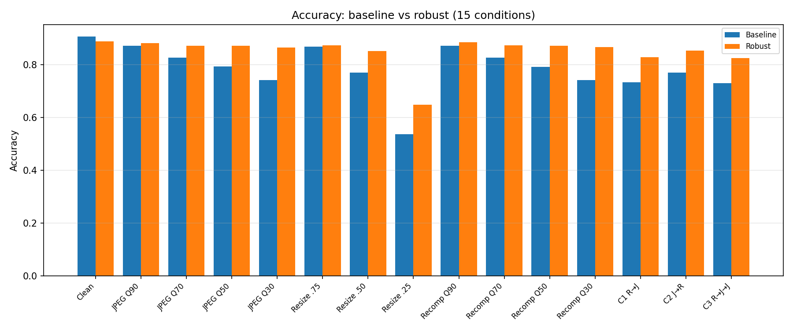
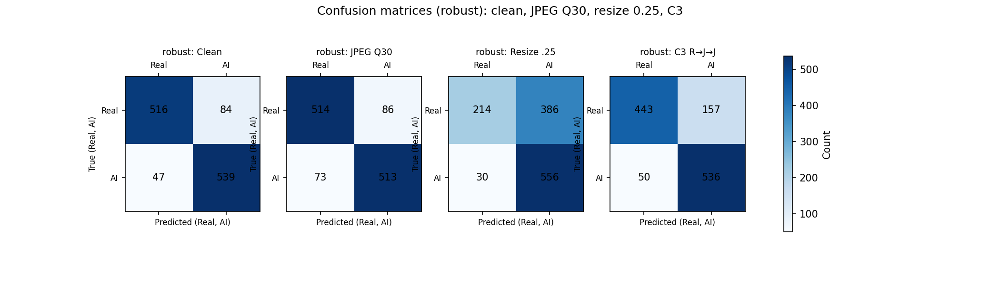

# Robust Detection of AI-Generated Images Under Social Media-Style Compression and Transformations: A Controlled Robustness Study with Transformation-Aware Training

## Title Page

**Project title:** Robust Detection of AI-Generated Images Under Social Media-Style Compression and Transformations

**Course:** AIML course project (Experimentation Based track).

**Institution:** L.D. College of Engineering, Ahmedabad.

**Team:** Ansh Panchal — experiments, evaluation, dashboard; Keval Pandya — documentation, presentation; Krish Panchal — data, models, training. (Roles per `AGENTS.md`; enrollment numbers and supervisor details are not recorded in the repository and are left for the title sheet.)

**Label convention used throughout:** 0 = Real, 1 = AI-generated. Confusion matrices list rows true, columns predicted.

## Abstract

Image detectors are usually scored on pristine files, yet deployed images are routinely recompressed and downscaled. We evaluated an EfficientNet-B0 Real-vs-AI detector on a frozen 1,186-image test set (600 Real / 586 AI) under 15 fixed conditions: clean, JPEG quality 90–30, resize scale 0.75–0.25, two-pass recompression quality 90–30, and three ordered combined pipelines. The clean baseline (accuracy 90.73%, AI recall 90.96%) degrades in two distinct, measured ways: JPEG-family transformations collapse AI recall (Q30: 55.46%), while resizing collapses Real precision with AI recall intact (resize 0.25: accuracy 53.71%, AI recall 90.61%). Pipeline order selects the failure mode. A transformation-aware fine-tune (fixed stochastic policy, best clean-validation epoch 8) restores AI recall across JPEG, recompression, combined, and held-out conditions — up to +36.69 percentage points — at a measured clean-accuracy cost of 1.77 points. All claims are bounded to the evaluated dataset and conditions.

## 1. Introduction

Synthetic imagery is inexpensive to produce and spreads through platforms that recompress and downscale nearly every upload. A detector that excels on laboratory files but fails on everyday transformations addresses the wrong problem. This project therefore treats robustness as the primary object of study rather than an afterthought: we fix the data, the model, the threshold, and the code, vary only the transformation, and measure what breaks — then test whether training with those transformations repairs it.

## 2. Problem Statement

Binary classification of images as Real (label 0) or AI-generated (label 1), evaluated under a fixed set of social-media-style degradations applied identically to both classes. The deliverable is not only a classifier but the measurement itself: thirty model-condition evaluations on identical data with an identical procedure, plus the scripts to reproduce them.

## 3. Motivation and Practical Relevance

Anyone relying on a published accuracy number assumes it transfers to real uploads. Our measurements show it does not: a 90.73% clean-accuracy detector misses nearly half of AI images at JPEG quality 30 (recall 55.46%) and flags most Real images as AI at 0.25 resize scale (494 of 600 false positives). Reporting robustness per transformation, with order recorded, is the practically relevant evaluation.

## 4. Research Question and Objectives

How do JPEG compression, resizing, recompression, and combined transformations affect AI-generated image detection, and can transformation-aware training improve robustness? Objectives: (1) quantify degradation per condition on a frozen test set; (2) compare a transformation-aware model head-to-head; (3) test transformation levels deliberately excluded from training.

## 5. Scope and Contributions

In scope: JPEG, resize, two-pass recompression, three ordered combined pipelines; clean/transformed comparison on 15 conditions; held-out-level evaluation; reproducible scripts and a read-only results dashboard. Out of scope: new generators, video, platform-in-the-loop testing, and any claim about unseen sources. Contributions: (1) a frozen 7,986-image benchmark with leakage audit; (2) two clean baselines with full metric records; (3) 15-condition controlled evaluation with per-image records; (4) a transformation-aware EfficientNet-B0 with a 30-row head-to-head comparison; (5) held-out-level generalization evidence within the dataset; (6) reproducible scripts and dashboard for every measurement.

## 6. Related Work

Zhu et al. (Mingjian Zhu, Hanting Chen, Qiangyu Yan, Xudong Huang, Guanyu Lin, Wei Li, Zhijun Tu, Hailin Hu, Jie Hu, Yunhe Wang), *GenImage: A Million-Scale Benchmark for Detecting AI-Generated Images*, arXiv:2306.08571 (2023; Huawei Noah's Ark Lab; also NeurIPS 2023 Datasets and Benchmarks) — the large-scale generator-diverse benchmark our subset is drawn from; it motivates evaluating across many generators rather than one. Grommelt, Weiss, Pfreundt, and Keuper, *Fake or JPEG? Revealing Common Biases in Generated Image Detection Datasets*, ECCV 2024 Workshops, LNCS vol. 15644, pp. 80–95 (arXiv:2403.17608) — shows GenImage detectors exploit JPEG-compression and size shortcuts and that removing such biases improves robustness; it motivates controlled, same-pipeline evaluation. Li, Ren, Wang, and Cao (Kai Li, Wenqi Ren, Wei Wang, Xiaochun Cao), *Detecting Compressed AI-Generated Images via Phase Spectrum Robustness*, Proc. CVPR 2026, pp. 35427–35436 — a compression-robust detector built on phase-spectrum stability; we adopt straightforward fine-tuning instead of specialized architectures, keeping the study feasible while testing the same practical question. No other literature is cited; a broader survey remains open team work.

## 7. Dataset Description and Preparation

We use a Tiny-GenImage subset (`data/splits/genimage_8000_split_v4/manifest.csv`, seed 42) with seven AI generators (ADM, BigGAN, GLIDE, Midjourney, SDv5, VQDM, Wukong). The source export targeted 8,000 images; 14 test/AI files were unrecoverable and excluded without substitution (recorded in the manifest `integrity_note`). Every image was readability-checked (7,986 readable, zero corrupted) and a full SHA-256 audit found zero exact cross-split duplicates, so no train/test leakage by content exists. Images themselves are gitignored; the manifest and `split_metadata.json` are committed.

## 8. Experimental Design and Evaluation Protocol

Train (5,600), validation (1,200), and test (1,186) splits have distinct purposes: gradient updates use train pixels only; checkpoint selection uses clean validation accuracy only; the test set is frozen before all experiments and never influences training, tuning, or selection. Every condition evaluates exactly n=1,186 (600/586) with identical ground-truth order, preprocessing, checkpoint, threshold 0.5, and code; each run embeds a clean control that must reproduce the baseline within 1e-4 or the run fails.

| Split | Real | AI-generated | Total |
|---|---|---:|---:|
| Train | 2,800 | 2,800 | 5,600 |
| Validation | 600 | 600 | 1,200 |
| Test (frozen) | 600 | 586 | 1,186 |
| Total | 4,000 | 3,986 | 7,986 |

## 9. System Architecture

*Figure 1 — Evaluation pipeline. Frozen splits → research transforms → fixed preprocessing → EfficientNet-B0 / ResNet-50 baselines and the robust model → threshold 0.5 → shared metrics. Identical for every reported number (`results/graphs/system_architecture_pipeline.png`, generated by `scripts/plot_system_architecture.py`).*

## 10. Image Preprocessing

Every image is decoded to RGB, resized to 224×224, converted to tensor, and ImageNet-normalized — identically for both classes, both models, and every condition. Research transformations are applied to fresh decoded copies strictly before this single final preprocessing; originals are never modified (size and modification time asserted unchanged in every run).

## 11. Baseline Model Architectures

EfficientNet-B0 and ResNet-50, each with a replaced two-class head emitting `[B, 2]` logits; predicted label is the argmax, AI probability the softmax AI-class entry. Both start from ImageNet-pretrained weights and train with Adam (lr/weight-decay 1e-4, 10 epochs, batch 16), selecting on clean validation accuracy.

## 12. Baseline Model Selection

Clean-test results (threshold 0.5, n=1,186): EfficientNet-B0 — accuracy 90.73%, precision 90.34%, AI recall 90.96%, F1 90.65%, ROC-AUC 0.9649, FNR 9.04%, CM [[543,57],[53,533]] (`results/metrics/baseline_efficientnet_b0_clean.json`); ResNet-50 — accuracy 90.81%, precision 94.09%, AI recall 86.86%, F1 90.33%, ROC-AUC 0.9682, CM [[568,32],[77,509]]. ResNet-50 is more accurate and precise, but EfficientNet-B0 was selected as primary because its AI recall is higher at comparable F1 — and missed AI images are the costliest error. The selection does not claim superiority on every metric.

| Metric | EfficientNet-B0 | ResNet-50 |
|---|---:|---:|
| Accuracy | 90.73% | 90.81% |
| Precision | 90.34% | 94.09% |
| AI recall | 90.96% | 86.86% |
| F1 | 90.65% | 90.33% |
| ROC-AUC | 0.9649 | 0.9682 |

## 13. Image Transformation Methods

JPEG quality Q ∈ {90, 70, 50, 30} (single in-memory encode–decode at fixed quality). Resize scale s ∈ {0.75, 0.50, 0.25} (aspect-preserving downscale; the lossy research step, distinct from the later 224×224 model resize). Recompression means two sequential same-quality JPEG passes — an operation distinct from single compression, implemented as `apply_recompression` (verified: second pass adds ~nothing at these levels). Combined pipelines C1/C2/C3 use the existing ordered `apply_pipeline`. Severity is controlled solely by the documented quality/scale/pass parameters.

## 14. Individual Transformation Experiments

`scripts/run_jpeg_robustness.py`, `run_resize_robustness.py`, `run_recompression_robustness.py` evaluate the frozen baseline on the untouched test set (1,186 each, both classes transformed).

| Condition | Accuracy | AI recall | ROC-AUC |
|---|---:|---:|---:|
| Clean | 90.73% | 90.96% | 0.9649 |
| JPEG Q90 / Q70 / Q50 / Q30 | 87.27% / 82.72% / 79.34% / 74.28% | 84.98% / 74.74% / 67.75% / 55.46% | 0.9432 / 0.9066 / 0.8755 / 0.8442 |
| Resize 0.75 / 0.50 / 0.25 | 86.85% / 77.07% / 53.71% | 95.39% / 95.90% / 90.61% | 0.9560 / 0.9273 / 0.6680 |
| Recomp Q90 / Q70 / Q50 / Q30 | 87.27% / 82.72% / 79.17% / 74.28% | 84.81% / 74.40% / 67.24% / 55.29% | 0.9428 / 0.9062 / 0.8750 / 0.8439 |

*Figure 2 — AI recall vs JPEG quality. The baseline curve falls to 55.46% at Q30; the robust curve stays near 88%.*

*Figure 3 — AI recall vs resize scale. Recall stays high for both models; accuracy (Table above) is where resizing hurts.*

## 15. Combined Transformations and Operation Order

C1 = Resize 50% → JPEG Q50; C2 = JPEG Q50 → Resize 50%; C3 = Resize → JPEG Q50 → JPEG Q50 (`scripts/run_combined_robustness.py`).

*Figure 4 — Combined pipelines. Left: AI recall (baseline vs robust). Right: false positives on Real images (separate scale). Same ingredients in C1/C2 produce mirror-image failures.*

Baseline: C1 accuracy 73.36%, AI recall 55.80% (FP 57 — Real side identical to clean); C2 accuracy 77.15%, AI recall 88.23% (FP 202); C3 accuracy 73.10%, AI recall 54.78% (FP 54). Order was investigated precisely because pipelines are otherwise identical; the result shows the last transformation dominates the error mode. No causal mechanism beyond the pattern is claimed.

## 16. Robust Training Methodology

`scripts/train_robust.py` fine-tunes all EfficientNet-B0 parameters from the baseline checkpoint on train pixels only. Each training presentation draws independently per image, identically for both classes (the sampler never inspects labels), on fresh copies: 40% clean, 20% JPEG Q∼{90,70,50,30}, 15% resize ∼{0.75,0.50}, 15% recompression Q∼{90,70}×2, 10% combined C1/C2 (seed 42). These proportions are per-sample sampling probabilities, not guaranteed dataset fractions. Deliberately held out: resize 0.25, recompression Q50/Q30, C3.

## 17. Training Configuration and Checkpoint Selection

Adam, lr/weight-decay 1e-4, 10 epochs, batch 16, CUDA enforced (clean failure otherwise), no flips. After each epoch the model is scored on the clean validation split; the checkpoint with the highest clean validation accuracy wins (ties → lower validation loss, then earlier epoch) — test data plays no role. Best: epoch 8, validation accuracy 0.9008. Artifacts: `models/robust/efficientnet_b0_robust_best.pth` (weights gitignored), history and policy JSONs committed.

| Setting | Value | Setting | Value |
|---|---|---|---|
| Init | baseline checkpoint | Optimizer | Adam 1e-4 / wd 1e-4 |
| Epochs / batch / seed | 10 / 16 / 42 | Selection | best clean-val acc, epoch 8 (0.9008) |
| Policy | 40 / 20 / 15 / 15 / 10 | Held out | resize 0.25, recomp Q50/Q30, C3 |

## 18. Experimental Results

*Figure 5 — AI recall across all 15 conditions. Robust bars match or exceed baseline in 13 of 15 (resize 0.75/0.50 dip negligibly).*

*Figure 6 — Accuracy across all 15 conditions: robustness improves most transformed scores at a small clean cost.*

## 19. Baseline-versus-Robust Comparison

Full 30-row table: `results/metrics/robust_evaluation_efficientnet_b0.csv`; deltas: `results/metrics/baseline_vs_robust_efficientnet_b0.csv`. Headline deltas (pp): clean accuracy −1.77 (90.73%→88.95%), clean AI recall +1.02; JPEG Q30 recall +32.08, C3 +36.69, C1 +35.67; resize dips −0.68/−0.85; unseen all improve. Robust AI recall improves in 13 of 15 conditions; the exceptions are resize 0.75 and 0.50. Recall gains are reported as recall gains — never as accuracy gains.

## 20. Held-out Transformation Evaluation

| Held-out condition | Baseline AI recall | Robust AI recall | Change |
|---|---:|---:|---:|
| Resize 0.25 | 90.61% | 94.88% | +4.27 pp |
| Recompression Q50 | 67.24% | 88.91% | +21.67 pp |
| Recompression Q30 | 55.29% | 87.54% | +32.25 pp |
| C3 | 54.78% | 91.47% | +36.69 pp |

These levels were excluded from the augmentation policy before training (see logged config), so the gains test policy-level rather than level-memorized robustness — within this dataset only. Resize 0.25 stays weakest in absolute terms (robust accuracy 64.92%).

## 21. Confusion Matrices and Error Analysis

Convention: rows true [Real, AI], columns predicted. Baseline clean [[543,57],[53,533]]; JPEG Q30 [[556,44],[261,325]] (AI misses explode); resize 0.25 [[106,494],[55,531]] (Real false alarms explode); C1 [[543,57],[259,327]] vs C2 [[398,202],[69,517]] (order flips the error side); robust C3 [[443,157],[50,536]] (misses cut from 265 to 50).

*Figure 7 — Robust-model confusion counts for clean, JPEG Q30, resize 0.25, and C3.*

## 22. Discussion and Interpretation

Measured patterns first: JPEG-family damage concentrates in AI false negatives; resize damage concentrates in Real false positives; pipeline order selects the failure mode. A cautious interpretation is that lossy compression erases the high-frequency cues this detector uses for the AI class, while downscaling blurs the texture cues distinguishing Real images — consistent with, but not proven by, the mirror-image confusion patterns. Transformation-aware training converts most JPEG-family collapse into preserved recall at modest clean cost; the held-out gains suggest policy-level rather than level-memorized robustness within this dataset. Resize 0.25 remains hard in absolute terms for both models.

## 23. Limitations and Threats to Validity

Single dataset and seven generators; one frozen test set reused across 30 model-condition evaluations (15 conditions × 2 models; never used for tuning, but comparisons share samples); 15 fixed transformation settings only; two architectures; no statistical-significance testing (report confidence intervals as future work — none claimed); exact GPU bit-reproducibility not claimed; base-environment NumPy/SciPy incompatibility documented (tests ran under `ml_clean`); no platform-in-the-loop, new-generator, or editor generalization tested. Findings must not be read as universal real-world robustness.

## 24. Reproducibility and Implementation Details

Fixed seed 42; frozen manifest and splits; deterministic preprocessing; pinned transformation parameters and order; per-condition JSON logs with run identifiers; clean controls reproducing the baseline within 1e-4 (asserted at runtime in every script). Reproduce with `scripts/verify_baseline.py`, `run_jpeg/resize/recompression/combined_robustness.py`, `run_robust_evaluation.py` (train via `scripts/train_robust.py`); figures via `scripts/plot_robustness_results.py`, `plot_combined_comparison.py`, `plot_system_architecture.py`; read-only dashboard via `streamlit run app/app.py`.

## 25. Conclusion

Under controlled conditions, transformation-aware training substantially improves JPEG/recompression/combined robustness and held-out-level generalization within this dataset — up to +36.69 pp AI recall — at a measured −1.77 pp of clean accuracy, while resize-0.25 remains difficult. Practically: train with the transformations you will face, record their order, lead with recall rather than accuracy, and never trust a clean-accuracy headline for deployed reliability.

## 26. Future Work

Significance testing with confidence intervals; frequency-aware or multi-scale architectures for the resize gap; real platform pipelines; broader generators; bias-mitigated data collection; browser-tested public deployment.

## References

- Zhu, Mingjian, Hanting Chen, Qiangyu Yan, Xudong Huang, Guanyu Lin, Wei Li, Zhijun Tu, Hailin Hu, Jie Hu, and Yunhe Wang. *GenImage: A Million-Scale Benchmark for Detecting AI-Generated Images.* arXiv:2306.08571, 2023. https://arxiv.org/abs/2306.08571
- Grommelt, Patrick, Louis Weiss, Franz-Josef Pfreundt, and Janis Keuper. *Fake or JPEG? Revealing Common Biases in Generated Image Detection Datasets.* In ECCV 2024 Workshops, LNCS vol. 15644, pp. 80–95. arXiv:2403.17608. https://arxiv.org/abs/2403.17608
- Li, Kai, Wenqi Ren, Wei Wang, and Xiaochun Cao. *Detecting Compressed AI-Generated Images via Phase Spectrum Robustness.* Proc. CVPR 2026, pp. 35427–35436. https://openaccess.thecvf.com/content/CVPR2026/html/Li_Detecting_Compressed_AI-Generated_Images_via_Phase_Spectrum_Robustness_CVPR_2026_paper.html

## Appendix A — Metric Definitions (positive class: AI-generated, label 1)

With TP/FP/TN/FN from the confusion convention above and P = TP+FN AI images, N = TN+FP Real images: accuracy = (TP+TN)/(P+N); precision = TP/(TP+FP); recall (AI recall) = TP/P; F1 = 2·precision·recall/(precision+recall); FPR = FP/N; FNR = FN/P = 1 − recall; ROC-AUC = area under the TPR–FPR curve swept over decision thresholds using continuous AI scores. Rate differences use percentage points (pp).

## Appendix B — Full Condition Table (baseline → robust AI recall, pp change)

Clean 90.96% → 91.98% (+1.02); JPEG Q90 84.98% → 91.13% (+6.14), Q70 74.74% → 89.76% (+15.02), Q50 67.75% → 89.08% (+21.33), Q30 55.46% → 87.54% (+32.08); Resize 0.75 95.39% → 94.71% (−0.68), 0.50 95.90% → 95.05% (−0.85), 0.25 90.61% → 94.88% (+4.27); Recomp Q90 84.81% → 91.47% (+6.66), Q70 74.40% → 89.42% (+15.02), Q50 67.24% → 88.91% (+21.67), Q30 55.29% → 87.54% (+32.25); C1 55.80% → 91.47% (+35.67), C2 88.23% → 93.17% (+4.95), C3 54.78% → 91.47% (+36.69). Source: `results/metrics/baseline_vs_robust_efficientnet_b0.csv`.

## Appendix C — Key Confusion Counts (rows true, columns predicted)

Baseline clean [[543,57],[53,533]]; JPEG Q30 [[556,44],[261,325]]; resize 0.25 [[106,494],[55,531]]; C1 [[543,57],[259,327]]; C2 [[398,202],[69,517]]; robust C3 [[443,157],[50,536]]. Source: per-condition CSVs under `results/confusion_matrices/` and `results/metrics/robust_evaluation_efficientnet_b0.csv`.

## Appendix D — Training Configuration

Fine-tuned from `models/baseline/efficientnet_b0_best.pth`; Adam, lr/weight-decay 1e-4, 10 epochs, batch 16, seed 42, CUDA; policy clean 40 / JPEG 20 / resize 15 / recomp 15 / combined 10 (C1/C2); unseen reserved resize-0.25, recomp-Q50/Q30, C3; best clean-val epoch 8 (0.9008). Source: `models/robust/robust_training_config.json`, `models/robust/robust_training_history.json`.
