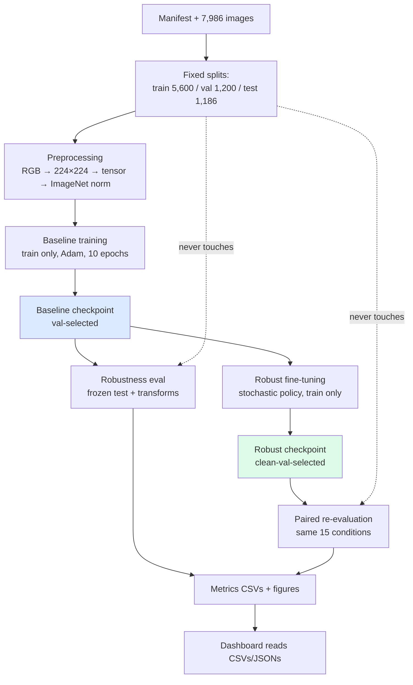

# Project Working Guide — Robust Detection of AI-Generated Images Under Social Media-Style Compression and Transformations

A beginner-friendly, end-to-end explanation of our project for **Ansh Panchal, Krish Panchal, and Keval Pandya** — what we built, how the code works, what the numbers mean, and how to present it confidently. Every technical claim below was checked against the actual repository files; paths like `src/dataset.py` refer to real files you can open.

## Table of Contents

- [Section 1 — The Project in Five Minutes](#section-1--the-project-in-five-minutes)
- [Section 2 — The Entire Project as a Simple Story](#section-2--the-entire-project-as-a-simple-story)
- [Section 3 — Repository Structure and File-by-File Explanation](#section-3--repository-structure-and-file-by-file-explanation)
- [Section 4 — Dataset: Where the Images Come From](#section-4--dataset-where-the-images-come-from)
- [Section 5 — Data Splitting and Leakage Prevention](#section-5--data-splitting-and-leakage-prevention)
- [Section 6 — Image Preprocessing Explained](#section-6--image-preprocessing-explained)
- [Section 7 — What EfficientNet-B0 and ResNet50 Actually Do](#section-7--what-efficientnet-b0-and-resnet50-actually-do)
- [Section 8 — Baseline Training and Model Selection](#section-8--baseline-training-and-model-selection)
- [Section 9 — Image Transformations: The Core of Our Research](#section-9--image-transformations-the-core-of-our-research)
- [Section 10 — How the Baseline Was Evaluated](#section-10--how-the-baseline-was-evaluated)
- [Section 11 — Understanding Our Evaluation Metrics](#section-11--understanding-our-evaluation-metrics)
- [Section 12 — Baseline Results: What Went Wrong?](#section-12--baseline-results-what-went-wrong)
- [Section 13 — Why We Introduced Transformation-Aware Training](#section-13--why-we-introduced-transformation-aware-training)
- [Section 14 — Training Versus Evaluation: Seen and Held Out](#section-14--training-versus-evaluation-what-was-seen-and-what-was-held-out)
- [Section 15 — Baseline Versus Robust Model: The Main Findings](#section-15--baseline-versus-robust-model-the-main-findings)
- [Section 16 — Why Transformation Order Matters](#section-16--why-transformation-order-matters)
- [Section 17 — The Interactive Dashboard: How It Works](#section-17--the-interactive-dashboard-how-it-works)
- [Section 18 — Architecture and End-to-End Workflow](#section-18--architecture-and-end-to-end-workflow)
- [Section 19 — Important Code Walkthrough](#section-19--important-code-walkthrough)
- [Section 20 — Limitations and What We Cannot Claim](#section-20--limitations-and-what-we-cannot-claim)
- [Section 21 — Common Questions From Faculty and Students](#section-21--common-questions-from-faculty-and-students)
- [Section 22 — Difficult Questions and Honest Answers](#section-22--difficult-questions-and-honest-answers)
- [Section 23 — Presentation Speaking Guide](#section-23--presentation-speaking-guide)
- [Section 24 — Glossary of Technical Terms](#section-24--glossary-of-technical-terms)
- [Section 25 — Quick Revision Sheet](#section-25--quick-revision-sheet)
- [Section 26 — Team Work Distribution and Individual Contributions](#section-26--team-work-distribution-and-individual-contributions)
- [Appendix — Items We Must Verify Before the Presentation](#appendix--items-we-must-verify-before-the-presentation)

---

## Section 1 — The Project in Five Minutes

**What problem are we solving?** The internet is full of AI-generated images, and people routinely compress or resize pictures when sharing them (think WhatsApp or Instagram). We built a system that tells **Real** photographs apart from **AI-generated** images, and then asked: does it still work after the image has been compressed or resized the way social media does it?

**Why is detecting AI-generated images difficult?** Real and AI images can look nearly identical to the human eye. A **CNN (convolutional neural network)** — a neural network designed to read images by scanning for small visual patterns like edges and textures — learns subtle statistical patterns from thousands of examples. But those patterns can be fragile: saving a file as a low-quality JPEG literally throws away fine image detail, which may include exactly the clues the model relies on.

**What happens when an image is compressed or resized?** JPEG compression with a low **quality setting** (a number from 1–100 controlling how much detail is kept; lower means smaller file, worse quality) discards high-frequency detail and adds blocky artifacts. Resizing to 0.25 scale shrinks each side to one quarter, destroying three-quarters of the pixels per side. Our measurements show the detector's behavior changes dramatically: at JPEG quality 30, it misses nearly half of all AI images.

**What exactly did our team build?** A complete pipeline: a frozen 7,986-image dataset with fixed train/validation/test splits; two trained baseline classifiers (EfficientNet-B0 as primary, ResNet50 for comparison); a transformation library (JPEG, resize, recompression, ordered pipelines); an evaluation framework; a transformation-aware fine-tuned ("robust") model; result tables, figures, and a Streamlit dashboard called **AI Image Robustness Lab** that displays the saved results.

**What does "robustness" mean here?** A precise, narrow thing: how little our detector's performance (especially **AI recall** — the share of AI images it catches) degrades when test images undergo the same transformations, compared against the clean baseline on identical images. It does *not* mean the model works on any image from the internet.

**Main components:** dataset + splits → preprocessing → baseline models → transformation experiments → robust training → comparison → dashboard.

**Most important findings:** (1) JPEG Q30 drops baseline AI recall from 90.96% to 55.46%; robust training restores it to 87.54%. (2) Resize 0.25 keeps AI recall high (~90%) but collapses accuracy to 53.71% because real images get flagged as AI. (3) Transformation order matters: Resize→JPEG gives 55.80% AI recall, JPEG→Resize gives 88.23%. (4) Robust training improves AI recall in 13 of 15 conditions at a cost of 1.77 percentage points of clean accuracy.

> **60-second version:** "We built an AI-image detector and stress-tested it the way social media stresses images — compression, resizing, and combinations. The baseline breaks badly: heavy JPEG makes it miss half the AI images. We then retrained it on transformed images, which fixed most of the damage — for example, JPEG Q30 recall went from 55% to 88% — at a small cost to clean accuracy. We also found that the *order* of transformations changes the result, and our dashboard lets you explore all 15 test conditions."

---

## Section 2 — The Entire Project as a Simple Story

Imagine training a bank clerk to spot counterfeit banknotes by showing them 5,600 genuine and fake notes. The clerk learns tiny tells — paper texture, print sharpness. That is our **training** step.

Now imagine testing the clerk, but first someone photocopies every test note twice (JPEG recompression) or shrinks them to stamp size (resize 0.25). Some tells survive photocopying; others vanish. That is our **robustness experiment**: we never retrain the clerk between tests — we just measure how the score changes as the damage increases.

Finally, we train a *second* clerk who practices on photocopied and shrunken notes from the start (transformation-aware training), then compare both clerks on the same damaged test notes. The second clerk does far better on damaged notes and only slightly worse on pristine ones. That comparison — 30 head-to-head evaluations — is our main result.

**Where the analogy stops:** a clerk understands money; our CNN understands nothing. It outputs numbers (logits converted to probabilities), and a fixed threshold of 0.5 turns those numbers into Real/AI decisions. "Learning a pattern" means adjusting ~4 million weights to reduce prediction error, not understanding images. And unlike photocopies, our transformations are exactly reproducible code with fixed quality levels and seeds.

---

## Section 3 — Repository Structure and File-by-File Explanation

Top-level layout (run `git status` / browse on GitHub to confirm; all paths below exist):

| Path | What it contains | What it does / when used | Essential? |
|---|---|---|---|
| `AGENTS.md` | Project rules, methodology constraints, team roles | Read first; governs every implementation decision | Yes (rules) |
| `README.md` | Project overview, setup, structure | First page for any visitor | Yes |
| `requirements.txt` | Pinned Python dependencies (torch, torchvision, numpy, pandas, Pillow, scikit-learn, matplotlib, tqdm, streamlit, jupyter) | `pip install -r requirements.txt` before running anything | Yes |
| `src/` | Reusable library: `dataset.py`, `preprocessing.py`, `model.py`, `train.py`, `transformations.py`, `evaluate.py`, `metrics.py`, `experiment_config.py`, `experiment_runner.py` | Imported by every script, notebook test, and suite | Yes |
| `scripts/` | One runnable file per experiment step (e.g. `verify_baseline.py`, `run_jpeg_robustness.py`, `train_robust.py`) plus plot scripts | Execute in experiment order; each writes to `results/` | Yes |
| `tests/test_ml_foundation.py` | 40 automated checks (dataset, preprocessing, models, smoke training) | Run after any `src/` change; requires CUDA for model tests | Yes |
| `data/splits/genimage_8000_split_v4/` | `manifest.csv` (7,986 rows) + `split_metadata.json`; image files live alongside locally but are gitignored | Source of truth for splits/labels; read by loaders | Yes |
| `models/baseline/`, `models/robust/` | `*_best.pth` checkpoints (gitignored, local) + committed `*_history.json` configs | Checkpoints loaded for evaluation; histories document training | Yes |
| `results/metrics/` | Metric JSONs/CSVs incl. `baseline_vs_robust_efficientnet_b0.csv` | Evidence for every reported number | Yes |
| `results/graphs/` | PNG figures used in report/slides/dashboard | Visual evidence | Yes |
| `results/confusion_matrices/`, `results/predictions/`, `results/experiment_logs/` | Per-condition counts, per-image predictions, run logs | Audit trail + error analysis | Supporting |
| `notebooks/ai_image_detection_robustness_analysis.ipynb` | 12-section executed walkthrough (24 cells) | Read to understand the full story; safe to re-run (read-only cells) | Yes (learning) |
| `app/app.py` | Streamlit dashboard (read-only results viewer) | `streamlit run app/app.py` | Yes (demo) |
| `docs/` | Protocol, report/plate sources, references, results reference, dev log, this guide | Write-up + audit trail | Yes |
| `__pycache__/`, `.ipynb_checkpoints/` | Auto-generated caches | Ignored; never commit | No |

**Execution order in practice:** `manifest.csv` → `src/dataset.py` loaders → `src/train.py` (`fit`) → `models/*_best.pth` → `scripts/run_*_robustness.py` → `results/metrics/*.csv` → `scripts/plot_*.py` → `results/graphs/` → `app/app.py` reads the CSVs.

**Essential vs generated:** `src/`, `scripts/`, `app/app.py`, `tests/`, configs, and docs are hand-maintained source. `results/` contents, `*_history.json`, and `__pycache__/` are generated outputs. Checkpoints (`.pth`) are large trained-weight files — kept locally, never committed.

---

## Section 4 — Dataset: Where the Images Come From

**Source.** Tiny-GenImage: a curated subset of the GenImage benchmark (Zhu et al.), which collects real photographs plus images from seven AI generators. In our manifest the AI generator names are `adm`, `biggan`, `glide`, `midjourney`, `sdv5`, `vqdm`, `wukong` (real photos carry the generator tag `real`). These names denote *which model family created the image* — useful context, though our classifier only ever predicts Real vs AI, never the generator.

**What Real/AI mean here.** A purely operational definition: `label = 0` means the image came from the real-photo collection; `label = 1` means it came from one of the seven generators. The model never sees *why* — only pixels and the 0/1 target.

**Organization on disk.** `data/splits/genimage_8000_split_v4/<split>/<label>/<filename>`, e.g. `.../test/ai/midjourney_00071.png`. The manifest's own `path` column contains a stale `/kaggle/working/...` prefix from the machine that built the split — our code deliberately ignores it and rebuilds paths from `root/split/label/filename` (see `src/dataset.py::_resolve_path`).

**How code reads images.** `load_manifest()` parses the CSV, maps the `label` string through `LABEL_MAP = {"real": 0, "ai": 1}` (anything else raises instead of guessing), and **refuses to proceed if any referenced file is missing from disk**. `GenImageDataset.__getitem__` then loads that exact file with `load_image()`, which converts every mode (JPEG, PNG, grayscale `L`, palette `P`, alpha `RGBA`) to RGB so the model always sees 3 channels.

**Missing/corrupt/duplicate handling.** Missing files → `ValueError`, fail loudly (this is how the 14 absent test/AI files were caught: the original 8,000-image target became a verified 7,986). Corrupt files → caught by PIL at load time (the audit recorded 7,986 readable, zero corrupted). Duplicates → a full SHA-256 hash audit found no exact duplicates across splits. No silent substitution was ever performed.

**Verified counts** (re-checked against `manifest.csv` during guide writing):

| Split | Real | AI-generated | Total |
|---|---|---:|---:|
| Training | 2,800 | 2,800 | 5,600 |
| Validation | 600 | 600 | 1,200 |
| Test | 600 | 586 | 1,186 |
| Total | 4,000 | 3,986 | 7,986 |

> **Remember:** the test set is short 14 AI images versus the symmetric 600/600 ideal. Every test metric in this project uses n = 1,186 — that is why denominators matter when you quote percentages.

---

## Section 5 — Data Splitting and Leakage Prevention

**Are splits pre-saved or generated?** Pre-saved and frozen: `manifest.csv` assigns every image a split once, with seed 42 recorded in `split_metadata.json`. Our code never re-splits; `load_manifest(..., split="test")` simply filters rows. Because splits are fixed files rather than random draws at runtime, every experiment from baseline to robust evaluation sees byte-identical test data.

**Stratification and seeds.** The committed split is approximately stratified (balanced classes in train/val; test 600/586 due to the missing files). Seed 42 governs training shuffling, weight initialization, and augmentation draws — it makes runs *reproducible on the same machine*, not magically better. (A **seed** is just the starting number of the random-number generator: same seed → same "random" sequence → same experiment.)

**What is data leakage?** Any path by which test information influences training or model choice — training on test images, tuning hyperparameters against test scores, or picking the checkpoint with the best *test* result. Leakage makes results look better than the model really is.

**How we prevent it (all verifiable in code):**
1. `src/train.py` builds **only train and validation loaders** — there is literally no test-loader construction in the training module.
2. `fit()` saves `*_best.pth` using the highest **validation** accuracy only.
3. Robust training (`scripts/train_robust.py`) loads train/val splits only; its test-set guard is asserted, and the suite checks "no test-split loader in training module".
4. Evaluation scripts load the test split read-only and never write back.

**How to verify no test-based selection:** open any `*_history.json` — it contains only `train_*`/`val_*` series plus `best_epoch`/`best_val_acc`; no test metric appears. The test CSVs are produced afterwards by separate `run_*` scripts.

---

## Section 6 — Image Preprocessing Explained

The exact pipeline (`src/preprocessing.py`, identical for Real and AI, train and eval except the flip):

```python
# build_eval_transform / build_train_transform(augment=False)
transforms.Resize((224, 224))        # 1. force exact model input size
transforms.ToTensor()                # 2. PIL 0–255  →  float tensor 0–1, H×W×C → C×H×W
transforms.Normalize(mean=[0.485, 0.456, 0.406],
                     std=[0.229, 0.224, 0.225])  # 3. ImageNet standardization
```

Line by line: **(1)** every image becomes exactly 224×224 pixels (our models physically require this shape). **(2)** A **tensor** is PyTorch's number grid — the model cannot read PIL images, only tensors of shape `[3, 224, 224]` (3 colour channels). **(3)** **Normalization** recenters each channel: `(pixel − mean) / std`, so inputs sit near zero instead of 0–255.

**Why ImageNet numbers?** Our models start from weights pretrained on ImageNet (see Section 7). Those weights *expect* inputs standardized with ImageNet's mean/std; feeding differently-scaled pixels would silently cripple a pretrained model. Nothing is fitted on our data — the constants are fixed.

**Related terms:** a **batch** is a stack of images processed together (e.g. 16 or 32) for GPU efficiency — the **GPU** (graphics card) does thousands of parallel arithmetic operations, which is why training/eval runs there instead of the CPU. **Consistency matters** because the model learns the statistics of preprocessed training images; evaluating with different preprocessing would measure the pipeline difference, not the model. Baseline training used `augment=False` (no flips), so train and eval preprocessing are effectively the same deterministic chain.

> **Common misunderstanding:** "Resize 0.25 means the model sees a tiny image." No — the *research* resize shrinks the image first (destroying detail), and *then* the standard 224×224 preprocessing upscales it back. The damage is the lost information, which upscaling cannot restore.

---

## Section 7 — What EfficientNet-B0 and ResNet50 Actually Do

**CNN in one paragraph.** A convolutional neural network scans an image with small learnable filters, building from edges → textures → object parts → a final decision. EfficientNet-B0 (~4.01M trainable parameters, verified by `count_parameters`) and ResNet50 (~23.5M) are two such architectures — one compact and efficient, one deeper with skip connections.

**Transfer learning** means not starting from zero: both models load **pretrained weights** — millions of numbers already trained on ImageNet's 1,000 everyday categories (dogs, cars, …). Those weights already encode edges, textures, and shapes, so our training only needs to re-specialize the network for Real-vs-AI. This is why ImageNet normalization (Section 6) is mandatory.

**What we change.** Only the final classification layer is replaced with a fresh 2-output linear layer (`model.classifier[1]` for EfficientNet-B0, `model.fc` for ResNet50); everything else keeps pretrained values as the starting point, then all parameters train.

**From image to prediction.** The model outputs two raw scores (**logits**, shape `[B, 2]` — *not* probabilities). Our evaluation applies **softmax**, which converts the two logits into two positive numbers summing to 1; the second entry is the **AI probability** (sigmoid would be used only for single-output models — ours are two-output, so softmax, per `src/evaluate.py::_ai_probability`). Threshold 0.5 on that probability gives the predicted class. So a "score of 0.87" means *the model assigns 87% probability to AI-generated*, and ≥ 0.5 → predicted AI.

**Checkpoints.** A **checkpoint** (`.pth` file) is a saved snapshot: architecture name + all weight values (+ training extras). The **baseline checkpoint** holds clean-trained weights; the **robust checkpoint** holds weights after transformation-aware fine-tuning starting *from* the baseline weights. Same architecture, same head, different numbers inside.

**Primary model.** EfficientNet-B0: clean accuracy 90.73% vs ResNet50's 90.81% looks like a tie — but EfficientNet's AI recall is 90.96% vs 86.86%. Since missing an AI image (false negative) is our costliest error, recall decides. EfficientNet is also ~6× smaller.

---

## Section 8 — Baseline Training and Model Selection

**The loop** (`src/train.py::fit`, defaults: Adam, lr 1e-4, weight-decay 1e-4, 10 epochs, batch 16, seed 42; actual baseline config in `models/baseline/efficientnet_b0_history.json` matches these):

1. **DataLoader** deals shuffled training batches (5,600 images ÷ batch 16 ≈ 350 batches per **epoch** — one full pass over the training set).
2. **Forward pass:** batch tensors → model → `[B, 2]` logits.
3. **Loss:** `CrossEntropyLoss` measures how far predicted probabilities are from the true 0/1 labels — one number per batch; lower is better.
4. **Backpropagation:** PyTorch computes how each weight contributed to that loss (chain rule, automatic).
5. **Optimizer step:** **Adam** nudges every weight to reduce the loss. The **learning rate** (1e-4) is the step size — too big diverges, too small crawls. **Weight decay** (1e-4) gently pulls weights toward zero, discouraging overfitting (memorizing training quirks).
6. After each epoch, score the untouched **validation** split (loss + accuracy).
7. **Selection:** keep the checkpoint with the highest *validation* accuracy (`*_best.pth`); test data is never loaded in this module, so it cannot influence the choice. Baseline best: epoch 8, val accuracy 0.895.

**Where training ran.** Baseline training used `src/train.py` (the walkthrough notebook explains but does not replace it). Robust fine-tuning used the separate entry point `scripts/train_robust.py` — same loop helpers, different data policy (Section 13).

> **Possible viva question:** "Why not pick the checkpoint with the best test score?" Because then the test set stops being an honest exam — you would be tuning answers to the questions. Validation exists precisely to be the practice exam; test is the final, seen once.

---

## Section 9 — Image Transformations: The Core of Our Research

All transformations live in `src/transformations.py`, operate on PIL images in memory (originals on disk are never modified), and apply identically to both classes. Severity is controlled only by the documented numbers — quality, scale, passes, order.

#### A. JPEG compression

`apply_jpeg_compression(image, quality)` saves the image into an in-memory JPEG buffer at the given **quality setting** Q (1–100) and reads it back. Lower Q = coarser quantization = smaller file, blockier image, more fine detail destroyed. We test Q90 (near-pristine), Q70, Q50, Q30 (heavy). RGBA images are safely converted to RGB first because JPEG has no transparency channel.

#### B. Resizing

`apply_resize(image, scale)` multiplies width and height by `scale` (0.75 → a 400×400 image becomes 300×300), preserving aspect ratio with BILINEAR resampling, then the normal 224×224 preprocessing still applies afterwards. So **scale 0.25 means each side shrinks to one quarter — the image keeps ~1/16 of its pixels — before being upscaled back to 224×224**. The upscaling cannot invent back the destroyed detail; that information loss *is* the experiment.

#### C. Recompression

`apply_recompression(image, quality, passes=2)` runs JPEG compression **twice in a row** at the same quality (save → reload → save again), mimicking an image re-uploaded across platforms. It is deliberately a separate function from single JPEG — and one of our findings is that the second pass adds almost no further damage (recompression tracks single JPEG within ~0.2 pp).

#### D. Combined transformations

Built with `apply_pipeline(image, [step1, step2, ...])`, which applies steps **in order** to a copy:

- **C1:** resize 0.50, then JPEG Q50.
- **C2:** JPEG Q50, then resize 0.50.
- **C3:** resize 0.50, then JPEG Q50, then JPEG Q50 again.

Why can order matter when the ingredients are identical? Because each operation destroys different information: JPEG damages fine detail while keeping size; downscaling discards pixels (then the 224-resize stretches what's left). JPEG-then-resize bakes compression blocks in and *then* smears them across fewer pixels, while resize-then-JPEG compresses an already small image. Our measurements confirm the outcomes differ enormously (C1 AI recall 55.80% vs C2 88.23%). We report the *pattern* — we do **not** claim a proven physical mechanism, and neither should you.

#### E. Transformation pipeline (trace one image)

Take `test/ai/midjourney_00071.png` under C1: (1) `load_image()` reads it → RGB PIL; (2) `apply_resize(…, 0.50)` → half-size PIL copy; (3) `apply_jpeg_compression(…, 50)` → Q50-degraded copy; (4) the eval transform resizes to 224×224, converts to tensor, normalizes; (5) the model outputs 2 logits → softmax → AI probability → threshold 0.5 → predicted label. Steps 2–3 come from `src/transformations.py`; step 4 from `src/preprocessing.py`; step 5 from `src/evaluate.py`. Nothing is saved to disk in between.

---

## Section 10 — How the Baseline Was Evaluated

Each `scripts/run_*_robustness.py` script does the same thing with different settings:

1. Load the **frozen test split only** (1,186 rows from the manifest; missing files would raise).
2. For each image: load → optionally transform (both classes, same code path) → standard preprocessing.
3. Batch through the frozen checkpoint (`evaluate_model` sets eval mode, disables gradients, moves batches to CUDA).
4. Convert `[B, 2]` logits → softmax → AI probability; predict AI if probability ≥ **threshold 0.5** (the same 0.5 for every condition and both models — changing it per condition would rig the comparison).
5. Compare predictions with true labels → `compute_classification_metrics` → confusion matrix + all metrics.
6. Assert everything (n=1,186, 600/586 classes, prediction order matches manifest, clean control reproduces baseline within 1e-4), then write metrics CSV + per-image predictions CSV + confusion-matrix CSV + JSON run log under `results/`.

> **Remember:** the threshold is applied to the **softmax AI probability**, not to raw logits. ROC-AUC, by contrast, uses the probabilities directly across *all* possible thresholds (Section 11).

---

## Section 11 — Understanding Our Evaluation Metrics

The **positive class is AI-generated (label 1)** — every metric below is defined around it.

| Metric | Plain English | Formula (TP=true AI caught, FP=real flagged, TN=real kept, FN=AI missed) |
|---|---|---|
| Accuracy | Share of all 1,186 images decided correctly | (TP+TN)/1186 |
| Precision (AI class) | Of images we *called* AI, share actually AI | TP/(TP+FP) |
| AI recall | Of truly-AI images, share we *caught* | TP/(TP+FN). **Our headline metric.** |
| F1-score | Balance of precision and recall | 2·P·R/(P+R) |
| ROC-AUC | Ranking quality over *all* thresholds (0.5 = random, 1.0 = perfect) | area under TPR–FPR curve |
| False-negative rate (FNR) | Share of AI images we *missed* = 1 − recall | FN/(TP+FN) |
| False positives | Real images wrongly flagged as AI (count, or FPR = FP/(FP+TN)) | — |

Illustrative confusion matrix (rows = truth, columns = prediction):

|  | Predicted Real | Predicted AI |
|---|---|---|
| **True Real** | TN = correctly kept | **FP = false alarm** |
| **True AI** | **FN = missed AI (evasion!)** | TP = correctly caught |

- **Real→AI error (FP):** an innocent photo flagged as fake — annoying, erodes trust.
- **AI→Real error (FN):** a synthetic image passes as real — the dangerous failure, and exactly what AI recall measures.
- **AI recall vs accuracy:** accuracy averages over everything; recall isolates "of the AI images, how many did we catch?" A model can keep 90% recall while accuracy collapses (resize 0.25: accuracy 53.71%, recall 90.61%) — because it flags *everything* as AI.
- **Precision vs recall:** precision asks "when we say AI, are we right?"; recall asks "of all AI, how much did we find?" Improving one can hurt the other.
- **Threshold vs ROC-AUC:** the threshold (0.5) turns one score into one decision; ROC-AUC summarizes decision quality across *every* threshold, so it cannot be gamed by moving 0.5.

**Why AI recall leads, but isn't enough alone:** catching AI images is the mission — but recall 100% is trivial if you call everything AI (precision and accuracy would collapse). Report it alongside accuracy, precision, and FNR.

---

## Section 12 — Baseline Results: What Went Wrong?

Verified clean baseline (EfficientNet-B0, n=1,186): accuracy **90.73%**, precision **90.34%**, AI recall **90.96%**, F1 **90.65%**, ROC-AUC **0.9649**, FNR **9.04%**. Solid — on pristine images.

**JPEG:** recall falls monotonically — Q90 84.98% → Q70 74.74% → Q50 67.75% → **Q30 55.46%**. Meaning: at heavy compression the detector misses nearly half of all AI images. Compression erases the fine detail the model depends on.

**Resize 0.25:** accuracy **53.71%** but AI recall **90.61%**, CM `[[106, 494], [55, 531]]` (rows true [Real, AI]). Read it: of 600 real images only 106 kept, **494 false alarms**; of 586 AI, 531 caught. The model didn't go blind — it panicked and called almost everything AI. High recall + terrible accuracy = indiscriminate flagging, the mirror image of the JPEG failure.

**ResNet50 comparison:** clean accuracy 90.81%, precision 94.09%, AI recall 86.86%, F1 90.33%, ROC-AUC 0.9682. Slightly more accurate and precise than EfficientNet — but recalls 4+ points less AI. Since FN (missed AI) is our costliest error and F1 is comparable, EfficientNet-B0 is the primary model. Say exactly that; never claim it wins on *every* metric (it doesn't — ResNet wins accuracy, precision, ROC-AUC).

> **Measured vs interpreted:** the numbers above are measured. "Compression erases the cues the model uses" is a reasonable *interpretation*; "JPEG destroys high-frequency GAN artifacts specifically" would be an unproven causal claim — don't make it.

---

## Section 13 — Why We Introduced Transformation-Aware Training

A model trained only on pristine images has never seen compression damage during learning — its first encounter is the test. Transformation-aware training shows such damage *during* training so the model can learn damage-invariant cues. Implementation (`scripts/train_robust.py`, entry point only — the loop reuses `src/train.py` helpers):

- Start **from the baseline checkpoint weights** (fine-tuning, not from scratch — faster and isolates the effect of the data policy).
- Every parameter trainable; same Adam/lr/weight-decay/epochs/batch/seed as baseline (lr 1e-4, wd 1e-4, 10 epochs, batch 16, seed 42, CUDA enforced, no flips).
- **Per-image independent draw** (`sample_augmentation(rng)`): each training presentation rolls `rng.random()` against cumulative thresholds 0.40/0.20/0.15/0.15/0.10 → clean / JPEG (Q uniform in {90,70,50,30}) / resize (scale uniform in {0.75,0.50}) / recompression (Q uniform in {90,70}, passes=2) / combined (C1 or C2 coin flip). So the mixture is **sampling probabilities per presentation**, not guaranteed dataset fractions — over 5,600 images × 10 epochs it averages out closely.
- The sampler **never inspects the label** (same code path, same probabilities for Real and AI — otherwise augmentation itself would encode the answer); transforms apply to a fresh `image.copy()` on Tn workers with per-worker seeded RNG streams.
- **Best checkpoint** = highest *clean validation* accuracy (ties → lower val loss, then earlier epoch): epoch 8, val accuracy 0.9008, val loss 0.4118 → `models/robust/efficientnet_b0_robust_best.pth`. Test data is never loaded here — verified by assertion and code inspection.

---

## Section 14 — Training Versus Evaluation: What Was Seen and What Was Held Out?

| Stage | Data | Conditions |
|---|---|---|
| Training (gradients) | Train 5,600 only | Clean 40%, JPEG{90,70,50,30} 20%, resize{0.75,0.50} 15%, recomp{90,70}×2 15%, C1/C2 10% |
| Selection (no gradients) | Clean val 1,200 only | Clean only |
| Final evaluation | Frozen test 1,186 only | All 15 conditions incl. held-out |

**Deliberately held out of training:** resize **0.25**, recompression **Q50/Q30**, and **C3**. These four were excluded from the augmentation policy *before* training (recorded in the training config), so gains there test whether the model learned something general rather than memorizing exact training settings.

> **Careful wording:** this is generalization *within our dataset to unseen transformation levels* — not proof the model handles unseen generators, platforms, or the open internet. Never claim an "external dataset" was used; there wasn't one.

---

## Section 15 — Baseline Versus Robust Model: The Main Findings

From `results/metrics/baseline_vs_robust_efficientnet_b0.csv` (30 rows; deltas below are **percentage points**, i.e. simple differences like 87.54 − 55.46 = +32.08 pp — *not* "32% better"):

| Condition | Baseline AI recall | Robust AI recall | Change |
|---|---|---:|---:|
| Clean | 90.96% | 91.98% | +1.02 pp (acc 90.73% → 88.95%, −1.77 pp) |
| JPEG Q30 | 55.46% | 87.54% | **+32.08 pp** |
| Resize 0.25 | 90.61% | 94.88% | +4.27 pp (acc 53.71% → 64.92%) |
| Recomp Q50 | 67.24% | 88.91% | +21.67 pp |
| Recomp Q30 | 55.29% | 87.54% | +32.25 pp |
| C3 | 54.78% | 91.47% | **+36.69 pp** |

Full sweep: JPEG +6.14/+15.02/+21.33/+32.08; recomp +6.66/+15.02/+21.67/+32.25; C1 +35.67, C2 +4.95. **AI recall improved in 13 of 15 conditions**; the two exceptions are resize 0.75 (−0.68 pp) and 0.50 (−0.85 pp) — tiny dips, not regressions of concern.

**The trade-off, stated honestly:** robust training costs 1.77 pp of clean accuracy (and precision falls 90.34% → 86.52%) because the model flags more aggressively overall (robust clean FP 84 vs 57). It is *not* universally better on every metric — it is decisively better at the mission (catching AI images under damage) at a small, measured clean cost. Say exactly that.

> **pp vs % — viva trap:** "+32.08 pp" means recall rose by 32.08 *points* (55.46 → 87.54). A "32% improvement" would mean something else (relative change ≈ +58%). Always say "percentage points" for our deltas.

---

## Section 16 — Why Transformation Order Matters

Measured (baseline, verified): **C1** (Resize 50% → JPEG Q50): AI recall **55.80%**, FP **57**. **C2** (JPEG Q50 → Resize 50%): AI recall **88.23%**, FP **202**. Same ingredients, opposite order — one collapses recall, the other floods false alarms. Check the matrices: C1's Real row (543 TN / 57 FP) is *byte-identical to clean* — the damage sits entirely in missed AI; C2's AI row stays strong while Real images collapse.

What this demonstrates: detector behavior is sensitive to the *pipeline*, so any robustness claim must record operation order, not just parameter values. What it does **not** demonstrate: a universal law ("the last operation always dominates") or a physical mechanism. Report the pattern; do not generalize it.

---

## Section 17 — The Interactive Dashboard: How It Works

**Launch:** `streamlit run app/app.py` (needs the `streamlit` package; no GPU, no checkpoints, no dataset images required). It is named **AI Image Robustness Lab** and opens with five sidebar sections: **Overview; Transformation Robustness; Model Comparison; Dataset Bias & Format; Methodology & Limitations** (see `SECTIONS` in `app/app.py`).

**What it displays:** Overview (KPIs + key findings computed from the comparison CSV); Transformation Robustness (family/metric/model/condition filters with grouped charts + pp-delta tables); Model Comparison (side-by-side metric tables, confusion counts with Actual/Predicted labels); Dataset Bias & Format (audit tables, format-diagnostic results, observed-vs-unproven split); Methodology & Limitations (splits, policy, metrics, scope). Plots come from `results/graphs/`; tables from the metrics CSVs.

**Critical fact for the viva:** the dashboard performs **zero inference**. Verified by inspection — `app/app.py` contains no `torch` import, no checkpoint loading, no `.pth` paths, no image uploader. Everything is precomputed: CSV/JSON files are loaded with pandas, deltas are re-checked against model rows (tolerance 1e-9), and missing files produce a friendly error, never invented numbers. Nothing is written to disk at runtime; figures are static PNGs plus Streamlit-native charts.

**What it does NOT do:** classify your uploaded photos, retrain anything, or prove an arbitrary image is real. Say so proactively if asked.

---

## Section 18 — Architecture and End-to-End Workflow



(The dotted lines are the point: test data flows *only* into evaluation, never into training or selection.) Notebook cells cover this story descriptively; `scripts/` execute each box; the dashboard displays the final box.

---

## Section 19 — Important Code Walkthrough

**1. `src/dataset.py::load_manifest`** — reads the CSV, maps labels via `LABEL_MAP`, resolves `root/split/label/filename`, raises on unknown labels or missing files. *Why:* one validated source of (split, label, path) triples. *Mistake to avoid:* trusting the manifest's own `path` column — it holds a dead `/kaggle/` prefix.

**2. `src/dataset.py::GenImageDataset.__getitem__`** — loads one file → RGB → optional transform → `(tensor, long-label)`. *Why:* uniform interface for train/val/test; metadata mode adds filename/split/generator for prediction logs.

**3. `src/preprocessing.py::get_transform`** — returns the train chain (optional flip) or the deterministic eval chain; raises if you request augmentation on val/test. *Why:* makes illegal pipelines unrepresentable.

**4. `src/transformations.py::apply_jpeg_compression`** — BytesIO JPEG round-trip at quality Q with RGBA-safe conversion; input never mutated. *Why:* reproducible, file-free degradation.

**5. `src/transformations.py::apply_resize` / `apply_recompression` / `apply_pipeline`** — proportional downscale (BILINEAR); N sequential JPEG passes; ordered callable list. *Why:* the vocabulary of Experiments 1–4; order preservation is what makes C1≠C2.

**6. `src/model.py::build_efficientnet_b0`** — torchvision pretrained backbone + fresh `Linear(in, 2)` head. *Why:* transfer learning in one call. *Mistake:* assuming the head is pretrained — it is randomly initialized and must be trained.

**7. `src/train.py::fit`** — epoch loop → `train_one_epoch` (forward, CrossEntropy, backward, Adam step) → `validate` (no-grad) → keep best-val-accuracy checkpoint + history JSON. *Why:* the single selection rule that keeps test data out of decisions.

**8. `scripts/train_robust.py::sample_augmentation`** — thresholded `rng.random()` roll + `rng.choice` levels; returns `(name, transform-or-None)`; label-blind by construction. *Why:* the entire training policy in ~25 lines.

**9. `src/evaluate.py::evaluate_model`** — eval mode + `no_grad`, batches to device, `[B,2]` logits → softmax → AI probability → 0.5 threshold → metrics dict + aligned arrays. *Why:* identical procedure for all 30 evaluations; restores the model's original mode afterwards.

**10. `src/metrics.py::compute_classification_metrics`** — sklearn accuracy/precision/recall/F1 (`pos_label=1`, `zero_division=0`), ROC-AUC from probabilities (or `None` if absent — never invented), 2×2 confusion matrix with fixed `[Real, AI]` label order. *Why:* one definition of every number in the report.

**11. `scripts/run_*_robustness.py`** — per-condition dataset wrapper + evaluate + **assertions** (n, class counts, order, clean-within-1e-4, weight/file immutability) + CSV/JSON outputs. *Why:* the assertions are the scientific controls made executable.

**12. `app/app.py::load_all`** — cached reads of the small metric/summary/audit JSON + CSVs with schema, finiteness, and delta-consistency validation. *Why:* the dashboard can only ever show validated saved data.

---

## Section 20 — Limitations and What We Cannot Claim

Honest, repository-grounded limits:

- **One dataset, seven generators, 15 conditions.** Nothing here says anything about other generators, real platforms (Instagram/WhatsApp pipelines differ), video, or cropped/edited images.
- **Shared frozen test set.** Reused across all conditions by design (fair comparison), but it is still one sample of images.
- **No significance testing.** Deltas are descriptive; we report no confidence intervals or p-values.
- **Threshold fixed at 0.5.** All conclusions are conditional on it; a different threshold trades precision against recall.
- **Clean-accuracy cost is real** (−1.77 pp). The robust model is not "better at everything."
- **Two architectures only**, both ImageNet-pretrained CNNs; no transformer/ViT comparison.
- **Dashboard is a viewer**, not a live detector; presenting it otherwise would mislead.
- **Bit-exact reproducibility** across machines/GPUs is not claimed (seed 42 governs our runs; CUDA kernels may still vary).

More compute/time would buy: significance analysis, more architectures and thresholds, real platform pipelines, broader generators, and bias-mitigated data collection.

> **Needs verification:** none of the above is speculative — each traces to code, configs, or the absence thereof. If asked about anything not listed here (e.g. inference speed, memory use), say "we didn't measure that" rather than estimating.

---

## Section 21 — Common Questions From Faculty and Students

### A. Problem and motivation

**What problem are you solving?**
*Short:* Telling Real photos from AI-generated images, and checking whether the answer survives everyday compression and resizing.
*Follow-up:* Concretely we measure how JPEG Q90–Q30, resize 0.75–0.25, double compression, and ordered combinations change a frozen detector's decisions — then fix it with transformation-aware training. See `docs/RESULTS_REFERENCE.md`.

**Why does compression affect AI-generated image detection?**
*Short:* Compression discards fine detail, which can include the subtle patterns the model relies on — our JPEG Q30 recall fell to 55.46%.
*Follow-up:* Note the asymmetry: JPEG kills recall (missed AI), resizing kills precision (false alarms). Don't claim a proven mechanism.

**What do you mean by robustness?**
*Short:* How little performance degrades under the 15 fixed transformations versus clean, on identical images.
*Follow-up:* Narrow and measured — not "works on the whole internet."

**What is the novelty or experimental contribution?**
*Short:* A fully controlled, reproducible robustness study: frozen splits, identical code/threshold/preprocessing across 30 head-to-head evaluations, held-out transformation levels, and the C1/C2 order finding — all with per-image records and scripts anyone can rerun.
*Follow-up:* We invented no architecture or dataset; the contribution is experimental rigor.

### B. Dataset and preprocessing

**Why did you choose Tiny-GenImage?**
*Short:* Real photos plus seven diverse AI generators in one benchmark with a fixed manifest, so results aren't tied to one synthesis method.
*Follow-up:* Generators in `manifest.csv`: adm, biggan, glide, midjourney, sdv5, vqdm, wukong.

**How many images did you use?**
*Short:* 7,986 total — 5,600 train, 1,200 validation, 1,186 test. (Verified against the manifest in Section 4.)

**Why are the train, validation, and test sets separate?**
*Short:* Train teaches, validation picks the checkpoint, test gives the one honest grade. Mixing them leaks answers into studying.

**Why is the test set imbalanced by 14 images?**
*Short:* 14 test/AI files were missing from the source export and excluded without substitution — so test is 600/586. All metrics use n = 1,186.

**Why do you resize to 224 × 224?**
*Short:* EfficientNet-B0 and ResNet50 physically require 224×224×3 inputs. (`IMAGE_SIZE` in `src/preprocessing.py`.)

**Why use RGB and ImageNet normalization?**
*Short:* RGB gives 3 consistent channels (all modes converted); the fixed ImageNet mean/std matches what the pretrained weights expect. See Section 6.

**What does seed 42 do?**
*Short:* Fixes shuffling, initialization, and augmentation draws so runs reproduce on the same machine. It doesn't improve results.

### C. Models and training

**Why EfficientNet-B0?**
*Short:* Best AI recall (90.96%) at comparable F1, and ~6× smaller than ResNet50 (4.01M vs 23.5M trainable params).

**Why compare it with ResNet50?**
*Short:* To show model selection was evidence-based: ResNet wins accuracy/precision/AUC, EfficientNet wins recall — and recall decides for a detector.

**What is transfer learning?**
*Short:* Starting from ImageNet-trained weights instead of random ones, then replacing and training the final 2-class layer (plus fine-tuning the rest).

**What is an epoch? / batch size? / optimizer?**
*Short:* Epoch = one full pass over 5,600 training images. Batch size = images per weight update (16 → ~350 updates/epoch). The optimizer (Adam) is the rule that nudges weights to reduce loss; lr 1e-4 is the step size; weight decay 1e-4 discourages overfitting.

**Why fine-tune instead of train from scratch?**
*Short:* Faster, needs less data, and isolates the effect of the augmentation policy since both models start from the same baseline weights.

**How is the best checkpoint selected?**
*Short:* Highest *clean validation* accuracy over 10 epochs (ties → lower val loss, then earlier epoch) — epoch 8 at 0.9008. Test never involved. (`scripts/train_robust.py`, history JSON.)

### D. Transformations and experimental design

**What is JPEG quality?**
*Short:* A 1–100 dial for detail preservation; we test 90/70/50/30. Lower = more damage. Implemented as in-memory save/reload (`apply_jpeg_compression`).

**What does resize 0.25 mean?**
*Short:* Each side shrinks to 25% (≈1/16 of pixels) *before* the standard 224×224 upscale — which cannot restore lost detail.

**What is recompression?**
*Short:* JPEG applied twice in a row at the same quality (`passes=2`), mimicking re-uploads. Finding: the second pass adds almost nothing.

**Why test C1 and C2 in different orders?**
*Short:* To test whether pipeline order matters. It does enormously: C1 recall 55.80% vs C2 88.23%.

**Why hold out four transformation conditions?**
*Short:* Gains on unseen levels (e.g. C3 +36.69 pp) test policy-level learning rather than memorizing exact training settings.

**How do you ensure the test set is not used during training?**
*Short:* Training code only ever constructs train/val loaders; selection uses validation JSONs; evaluation scripts are separate files that only read test data. See Section 5.

**What does generalization mean here?**
*Short:* Only this — better scores on transformation levels excluded from training, within our dataset. Nothing about the open internet.

### E. Metrics and results

**Why use AI recall?**
*Short:* Because a missed AI image (false negative) is the dangerous failure. Defined with AI as the positive class (`pos_label=1`).

**What is the difference between accuracy and recall?**
*Short:* Accuracy = correct over everything; recall = caught over all AI. Resize 0.25 shows 53.71% accuracy with 90.61% recall — the model flags almost everything as AI.

**What is a false positive?**
*Short:* A Real image wrongly called AI (e.g. 494 of 600 real images at resize 0.25 baseline).

**Why can recall remain high while accuracy is low?**
*Short:* See above — indiscriminate AI predictions keep recall while destroying accuracy and precision.

**What does ROC-AUC tell us?**
*Short:* Ranking quality across *all* thresholds (1.0 perfect, 0.5 random). Ours: baseline clean 0.9649; it separates threshold choice from model quality.

**Why did clean accuracy decrease after robust training?**
*Short:* The robust model flags more aggressively (clean FP 57 → 84): it catches slightly more AI (+1.02 pp recall) at the cost of more false alarms — hence 90.73% → 88.95% (−1.77 pp). An honest, measured trade-off.

**What does improvement in 13 of 15 conditions mean?**
*Short:* Robust AI recall beats baseline in 13 conditions; the 2 exceptions are tiny resize dips (−0.68/−0.85 pp). Count refers to recall, not every metric.

**Does the model detect every AI-generated image correctly?**
*Short:* No. Even robust Q30 misses ~12% (recall 87.54%), and resize 0.25 accuracy is only 64.92%. Quote these numbers.

### F. Application and future work

**Does the live dashboard run inference on new images?**
*Short:* No — it only displays saved CSVs/JSONs/PNGs. No uploads, no torch, no checkpoints. Verified by inspecting `app/app.py`.

**Where are the experiment results stored?**
*Short:* `results/metrics/` (CSVs/JSONs), `results/graphs/`, `results/confusion_matrices/`, `results/predictions/`, `results/experiment_logs/`; training configs beside the checkpoints.

**Can the model identify which AI generator created an image?**
*Short:* No — it predicts only Real vs AI. Generator names exist in the manifest as metadata, never as training targets.

**Can it detect images generated by unseen AI models?**
*Short:* Untested — our generators are fixed, and "unseen" in our report means unseen *transformation levels*, not unseen generators. Say so explicitly.

**What are the limitations?**
*Short:* One dataset, 15 conditions, two CNNs, fixed 0.5 threshold, no significance testing, viewer-only demo. See Section 20.

**How would you improve the project with more time?**
*Short:* Significance analysis, more architectures/thresholds, real platform pipelines, broader generators, bias-mitigated data. All listed in the report's future work — nothing invented here.

---

## Section 22 — Difficult Questions and Honest Answers

**What exactly did your team implement yourselves?**
We wrote the dataset plumbing, transformation library, training/evaluation orchestration, experiment scripts, metrics wrappers, dashboard, and docs — reusing torchvision architectures, ImageNet weights, sklearn metrics, and standard libraries. Per `AGENTS.md`, AI coding assistance was used and the team reviewed, tested, and approved the result. Never claim we invented EfficientNet, Adam, or GenImage.

**How can you demonstrate that the test set was not used for model selection?**
Three independent facts: (1) `src/train.py` cannot construct a test loader; (2) every `*_history.json` contains only train/val series; (3) selection code compares `val_acc` only. Invite them to read `fit()` — it is short.

**Why should we trust the reported metrics?**
Because every number is recomputable: frozen manifest → versioned scripts → saved per-image predictions → CSVs whose clean controls reproduce the baseline within 1e-4 (asserted at runtime, run fails otherwise). Offer to re-run `scripts/verify_baseline.py` live if CUDA is available.

**What is the strongest evidence that the robust model generalizes?**
The four held-out conditions (resize 0.25, recomp Q50/Q30, C3) were excluded from the augmentation policy *before* training and all improved — C3 by +36.69 pp. Then immediately scope it: within our dataset only.

**Why does clean accuracy decrease? / Why only 13 of 15?**
More aggressive flagging (FP 57→84 clean); the two misses are sub-1pp recall dips on resize 0.75/0.50 where the baseline was already near-ceiling (~95–96%). Trade-offs, not failures.

**Will this work on Instagram/WhatsApp/every platform?**
Untested — say so plainly: "Our transforms approximate sharing damage; real platform pipelines were never evaluated. That is listed future work." Never extrapolate.

**Is this production-ready?**
No. It is a controlled experiment with a viewer dashboard, two architectures, one dataset, and no significance testing. Say it with confidence — knowing the boundary *is* the expertise.

**What is genuinely new?**
Not an algorithm: the controlled 30-evaluation comparison on frozen data, the held-out-level design, and the documented order effect (C1 vs C2) with full reproducible artifacts.

**Custom code vs libraries?**
Custom: dataset/transform/train-orchestration/eval-runner/dashboard glue (~all of `src/`, `scripts/`, `app/`). Borrowed: torchvision models + ImageNet weights, sklearn metrics, PIL/torch/pandas/Streamlit. Pretrained weights are borrowed; every experimental finding is ours.

**What would you change repeating it?**
Pre-register significance analysis, add threshold sweeps, include a transformer architecture, collect bias-balanced data, and test one real platform pipeline end-to-end.

> **Delivery tip:** answer the question asked in one sentence first, then offer exactly one supporting number or file. Never bluff past a "we didn't measure that."

---

## Section 23 — Presentation Speaking Guide

Our deck (`docs/PRESENTATION_SOURCE.md`): 11 slides + terminology appendix. For each slide — message, what to say (20–45 s), which visual to explain, one likely question.

**Slide 1 — Title and main result (1 min).** Message: compression breaks detection; training fixes most of it. Say: "We stress-tested an AI-image detector the way social media stresses images, then retrained it on damaged images — JPEG Q30 recall went from 55% to 88% at a small clean cost." Visual: title only. *Likely Q: "What do you mean by robust?"* → "How little performance degrades under our 15 fixed transformations."

**Slide 2 — Problem and RQ (1.5 min).** Message: clean benchmarks overstate deployed reliability. Say: "Detectors are graded on pristine files but deployed on recompressed uploads; our question asks how big that gap is and whether training closes it." Mention Real=0/AI=1 here. *Likely Q: "Why should we care?"* → "A 91%-accurate detector missing half of AI images after compression."

**Slide 3 — Objectives and approach (1 min).** Say: "Three goals — measure the damage, fix it with transformation-aware training, and test held-out levels — all on one frozen test set with identical code." *Likely Q: "Why frozen?"* → fairness across all 30 evaluations.

**Slide 4 — Dataset and design (1.5 min).** Point at the split table (5,600/1,200/1,186; 7 generators). Say: "Note 586, not 600, AI test images — 14 files were missing from the source and excluded, never substituted." *Likely Q: "Why imbalanced test?"* → that answer.

**Slide 5 — System architecture and setup (1.5 min).** Walk the pipeline diagram left to right; name EfficientNet-B0 primary with the recall rationale (90.96% vs 86.86%). *Likely Q: "Why not ResNet, it's more accurate?"* → "Accuracy ties; recall decides for a detector."

**Slide 6 — What happened to the baseline? (2 min).** Explain the JPEG-quality curve falling to 55.46% at Q30. Say: "Compression makes AI images invisible to the model." *Likely Q: "Is lower quality always worse?"* → "Monotonically in our measurements — show the table."

**Slide 7 — Training for transformed images (1.5 min).** Explain the 40/20/15/15/10 per-image draw with a coin-flip analogy; stress both-classes-identical and the held-out list. *Likely Q: "Does augmentation leak the label?"* → "The sampler never sees labels — same probabilities for Real and AI."

**Slide 8 — Baseline versus robust (2 min).** Point at grouped bars: gains concentrate where baseline collapsed; state the −1.77 pp clean cost in the same breath. *Likely Q: "Is the robust model just always better?"* → "No — clean accuracy and two resize dips; it wins the mission, not every metric."

**Slide 9 — Held-out results (1.5 min).** Emphasize C3 +36.69 pp on never-trained data as the generalization evidence, scoped to our dataset. *Likely Q: "Does this prove real-world generalization?"* → "No — unseen levels, not unseen platforms."

**Slide 10 — Why order matters (1.5 min).** Contrast C1 (55.80%, FP 57) vs C2 (88.23%, FP 202): same ingredients, opposite failures. Say: "So a robustness claim must record operation order." *Likely Q: "Why does order matter?"* → "We report the measured pattern; the mechanism is unproven — say exactly that."

**Slide 11 — Conclusion (1 min).** Restate: damage measured, largely repaired, order matters, scope bounded. End on the trade-off sentence, not apologies.

**60-second version:** (use Section 1's 60-second paragraph verbatim.)
**Two-minute faculty version:** 60-second version + "Methodologically: frozen 1,186-image test, identical code and threshold across 30 evaluations, held-out transformation levels, per-image records for everything — and the honest costs: 1.77 points of clean accuracy, no significance testing yet, one dataset."

---

## Section 24 — Glossary of Technical Terms

| Term | Plain English | In our project |
|---|---|---|
| AI-generated image | Picture synthesized by a generative model, not a camera | Label 1; from adm/biggan/glide/midjourney/sdv5/vqdm/wukong |
| CNN | Network scanning images with small pattern filters | EfficientNet-B0, ResNet50 |
| Transfer learning | Reusing ImageNet-trained weights instead of starting random | Both baselines start pretrained; only heads are fresh |
| EfficientNet-B0 | Compact CNN (~4.01M params here) | Primary model (recall 90.96%) |
| ResNet50 | Deeper CNN with skip connections (~23.5M params) | Comparison baseline (recall 86.86%) |
| Dataset split | Fixed train/val/test partitions | manifest.csv; 5,600/1,200/1,186 |
| Data leakage | Test info influencing training/selection | Prevented: no test loader in `train.py`, val-only selection |
| Preprocessing | Load → RGB → resize 224 → tensor → ImageNet norm | `src/preprocessing.py`, identical for all |
| Normalization | `(pixel−mean)/std` per channel | Fixed ImageNet constants, fitted on nothing of ours |
| Tensor | PyTorch's number grid; model input `[3,224,224]` | What `ToTensor()` produces |
| Batch | Images processed together (16 or 32) | GPU efficiency unit |
| Epoch | One full pass over 5,600 training images | 10 total; ~350 updates each at batch 16 |
| Learning rate | Optimizer step size (1e-4) | Too big diverges, too small crawls |
| Weight decay | Gentle pull of weights toward zero (1e-4) | Fights overfitting |
| Optimizer | Rule updating weights from gradients (Adam) | `build_optimizer` in `src/train.py` |
| Checkpoint | Saved weights + metadata (`.pth`) | `*_best.pth` (gitignored) + committed history JSONs |
| Fine-tuning | Continuing training from existing weights | Robust model starts from baseline checkpoint |
| JPEG quality | 1–100 detail dial | Tested Q90/70/50/30 |
| Recompression | JPEG applied twice (`passes=2`) | Mimics re-uploads; 2nd pass adds ~nothing |
| Transformation pipeline | Ordered steps, e.g. C1/C2/C3 | `apply_pipeline`, order preserved |
| Threshold | Score cutoff for AI verdict (0.5) | On softmax AI probability; fixed everywhere |
| Accuracy | Share of all decisions correct | 90.73% baseline clean |
| Precision | Of AI verdicts, share correct | 90.34% baseline clean |
| Recall | Of true AI, share caught | 90.96% baseline clean; headline metric |
| F1-score | Balance of precision and recall | 90.65% baseline clean |
| ROC-AUC | Ranking quality across all thresholds | 0.9649 baseline clean |
| False positive | Real image called AI | 494/600 at resize-0.25 baseline |
| False negative | AI image called Real | 261/586 at JPEG-Q30 baseline |
| Confusion matrix | 2×2 counts, rows true / cols predicted | `[[TN,FP],[FN,TP]]` per condition |
| Generalization | Holding up on unseen settings | Here: held-out *levels* only, not new platforms |
| Robustness | Small degradation under our 15 transforms | Measured vs clean on identical images |
| Overfitting | Memorizing train quirks | Countered by wd, val selection, clean policy share |
| Validation | Practice exam for checkpoint choice | 1,200 images, clean, selects epoch 8 |
| Inference | Running a trained model to predict | Eval scripts + `evaluate_model` (no learning) |

---

## Section 25 — Quick Revision Sheet

- **Objective:** measure transformation damage to AI-image detection; fix it with transformation-aware training.
- **Models:** EfficientNet-B0 primary (90.73% acc, 90.96% rec) vs ResNet50 (90.81%, 86.86%); ~4.01M vs ~23.5M params.
- **Data:** 7,986 (5,600 / 1,200 / 1,186); test 600 Real + 586 AI; seed 42; 224×224 RGB + ImageNet norm.
- **Training mix:** 40 clean / 20 JPEG / 15 resize / 15 recomp / 10 combined (per-image draws); Adam 1e-4/1e-4, 10 epochs, batch 16, no flips, CUDA.
- **Best checkpoint:** robust epoch 8, val acc 0.9008, val loss 0.4118; threshold 0.5.
- **Clean:** 90.73% → 88.95% acc (−1.77 pp); recall 90.96% → 91.98%.
- **JPEG Q30:** recall 55.46% → 87.54% (+32.08 pp).
- **Held-out:** resize-0.25 +4.27, recomp-Q50 +21.67, recomp-Q30 +32.25, C3 +36.69 pp recall.
- **C1 vs C2:** 55.80% (FP 57) vs 88.23% (FP 202) — order matters.
- **Top limitation:** one dataset, 15 conditions, viewer-only demo, no significance testing.
- **Five must-remember points:** (1) identical frozen test everywhere; (2) recall is the headline, pp not %; (3) resize fails via false alarms, JPEG via misses; (4) C1≠C2 proves order matters; (5) robust wins the mission, not every metric.

---

## Section 26 — Team Work Distribution and Individual Contributions

| Member | Primary technical responsibilities | Documentation responsibilities | Presentation responsibilities |
|---|---|---|---|
| **Ansh Panchal** — Experiments and Model Evaluation | JPEG/resize/recompression/combined experiments; EfficientNet-B0 transformation-aware fine-tuning; baseline-vs-robust comparison (accuracy, AI recall, precision, F1, ROC-AUC, confusion matrices); held-out and order-effect analysis (`src/transformations.py`, `src/evaluate.py`, `src/metrics.py`, `src/experiment_*.py`, `scripts/run_*` + `train_robust.py`, `results/`) | Experiment logs and metric records; robust-training config/history | Second half: robust training, comparative results, unseen conditions, transformation order, conclusions |
| **Krish Panchal** — Dataset Pipeline and Project Report | Dataset preparation and train/val/test splits; image loading, labels, preprocessing, integrity checks (`src/dataset.py`, `src/preprocessing.py`, `src/model.py`, `src/train.py`, `data/splits/…`, `tests/`) | Detailed project report: methodology, implementation, experiments, results, conclusions (`docs/FINAL_PROJECT_REPORT.md`, `docs/RESULTS_REFERENCE.md`) | Baseline/training support as needed |
| **Keval Pandya** — Streamlit Dashboard and First Half of Presentation | **AI Image Robustness Lab** dashboard: navigation, comparison/transformation/bias/methodology views, result visualization (`app/app.py`, `results/graphs/`) | Presentation materials | First half: problem, objectives, dataset, architecture, baseline results |

**How the three areas connect:** Krish's pipeline (manifest → loaders → trained checkpoints) feeds Ansh's experiments (frozen test + transforms → 30 evaluations → comparison tables), which feed Keval's dashboard (saved CSVs/figures → interactive sections) and both halves of the presentation. The report (Krish, from shared evidence) and this guide (shared study aid) close the loop.

**Agreed allocation vs verified authorship:** the table above records the team's agreed distribution (stated in the task brief and consistent with `AGENTS.md` roles). The repository does not track who typed each line — no commit-history or authorship claims are made here. Each member should be able to explain their own area *and* summarize the other two using this guide.

> **Remember:** the project blends **experimental ML research** (Ansh), **dataset and training-pipeline work** (Krish), and **application development with visualization** (Keval) — one study, three complementary crafts.

---

## Appendix — Items We Must Verify Before the Presentation

- [ ] Dashboard launches live (`streamlit run app/app.py`) on the presentation machine — headless boot was verified, live browser interaction was not.
- [ ] Slide deck built from `docs/PRESENTATION_SOURCE.md`; Overview screenshot captured from the running app if used.
- [ ] Confirm enrollment numbers, supervisor, department, and academic year for the title slide (not in the repo — do not guess).
- [ ] Re-run `python tests/test_ml_foundation.py` on the presentation machine if live demos are planned.
- [ ] Bring `docs/RESULTS_REFERENCE.md` (printed or open) as the single source for any number quoted on stage.
- [ ] Rehearse the Section 22 answers aloud — especially Instagram/WhatsApp, production-readiness, and novelty questions.

*End of guide. If a claim in here ever conflicts with `results/` CSVs, the CSVs win — please file the discrepancy rather than editing numbers by hand.*
